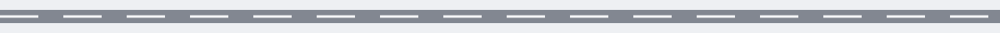

# codeintel-Improper-Exception-Handling-Checker

Detects instances of empty 'except' blocks or generic exception handling that might mask underlying issues or security vulnerabilities, preventing proper error handling and potentially leading to unexpected behavior. - Focused on Tools for static code analysis, vulnerability scanning, and code quality assurance

## Install
`git clone https://github.com/ShadowStrikeHQ/codeintel-improper-exception-handling-checker`

> **Log entry taped to the van window: the obtaining line is flagged.** The install line above names ShadowStrikeHQ, not ShadowGuard-AI. It is preserved exactly as printed in the live file and flagged here in place. It is not corrected in place.

## Usage
`./codeintel-improper-exception-handling-checker [params]`

> **The README Names No Path.** The running line above is a placeholder. It names no target path and no tool flag. Code fact, marked as a code fact and not as README text: the program requires a positional path naming a Python file or a directory.

## Parameters
- `-h`: Show help message and exit
- `--report_file`: No description provided
- `--exclude`: Comma-separated list of files or directories to exclude from analysis.
- `--tool`: No description provided

> **The Findings Come from the Chosen Tool.** One run uses one tool only, chosen with the tool option, and a full picture needs four separate runs lined up by hand. A result of None means failure and the run exits 1. An empty string means a clean tool run: an empty report then prints and the run exits 0.

## License
Copyright (c) ShadowStrikeHQ
